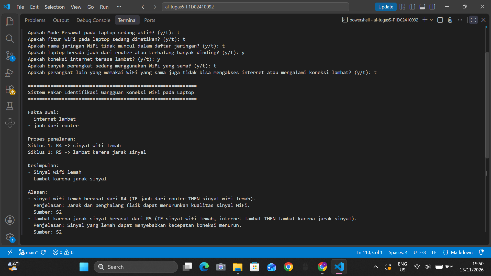
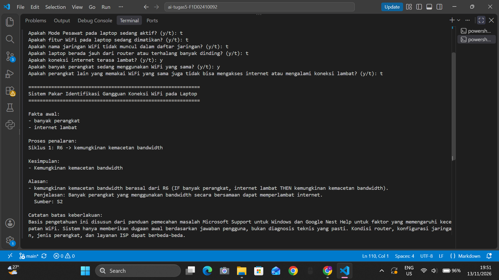
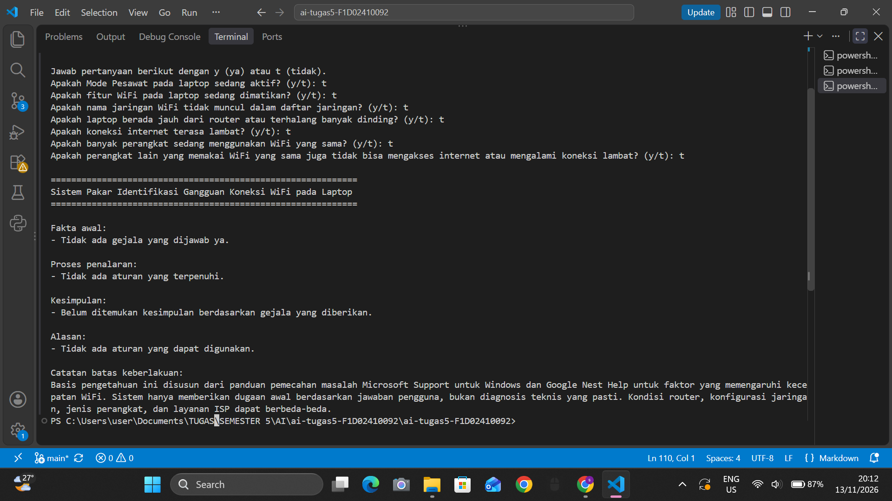

# Sistem Pakar Identifikasi Gangguan Koneksi WiFi pada Laptop

## 1. Identitas
- Nama: Sabrina Mawadathun Salsabila
- NIM: F1D02410092

## 2. Deskripsi
Program ini merupakan sistem pakar sederhana untuk mengidentifikasi kemungkinan penyebab gangguan koneksi WiFi pada laptop. Pengguna menjawab pertanyaan mengenai kondisi WiFi, kemudian sistem mencocokkan jawaban dengan aturan IF-THEN dan menampilkan kesimpulan beserta alasan dan sumber aturan.

Topik ini dipilih karena gangguan koneksi WiFi sering dijumpai dalam penggunaan laptop dan memiliki beberapa kemungkinan penyebab, misalnya Mode Pesawat aktif, WiFi dinonaktifkan, sinyal lemah, penggunaan bandwidth yang berlebihan, atau masalah pada router/ISP.

## 3. Cara Menjalankan Program
**Bahasa:** Python 3

Tidak memerlukan library tambahan. Pastikan `main.py` dan `kb_wifi.json` berada dalam folder yang sama.

Jalankan melalui terminal:
```bash
python main.py
```
Pada beberapa komputer Windows, perintahnya dapat menggunakan:
```bash
py main.py
```

## 4. Sumber Pengetahuan
| Kode | Judul | Penerbit | URL | Tanggal akses |
|---|---|---|---|---|
| S1 | Memperbaiki masalah koneksi Wi-Fi di Windows | Microsoft Support | https://support.microsoft.com/id-id/windows/experience/connectivity-networking/fix-wi-fi-connection-issues-in-windows | 13 November 2026 |
| S2 | Memecahkan masalah internet lambat di Google Nest Wifi atau Google Wifi | Google Home and Nest Help | https://support.google.com/googlehome/answer/6246489?hl=id | 13 November 2026 |

## 5. Basis Aturan IF-THEN
| ID | IF (syarat) | THEN (kesimpulan) | Sumber |
|---|---|---|---|
| R1 | Mode Pesawat aktif | Gangguan Mode Pesawat | S1 |
| R2 | WiFi laptop nonaktif | WiFi laptop dimatikan | S1 |
| R3 | Jaringan tidak ditemukan DAN WiFi nonaktif | Periksa pengaturan adaptor WiFi | S1 |
| R4 | Laptop jauh dari router | Sinyal WiFi lemah | S2 |
| R5 | Sinyal WiFi lemah DAN internet lambat | Lambat karena jarak/sinyal | S2 |
| R6 | Banyak perangkat DAN internet lambat | Kemungkinan kemacetan bandwidth | S2 |
| R7 | Perangkat lain juga bermasalah | Kemungkinan masalah router atau ISP | S1 |
| R8 | Kemungkinan masalah router/ISP DAN internet lambat | Periksa router dan hubungi ISP | S2 |

R4 menghasilkan fakta `sinyal_wifi_lemah` yang kemudian digunakan oleh R5. R7 menghasilkan fakta yang digunakan oleh R8. Dengan demikian, terdapat rantai penalaran ant aturan.

## 6. Metode Forward Chaining
Metode yang digunakan adalah **Forward Chaining (FC)**, yaitu metode penalaran yang dimulai dari fakta awal untuk memperoleh kesimpulan.

Langkah-langkah:
1. Program membaca basis pengetahuan dari `kb_wifi.json`.
2. Pengguna menjawab pertanyaan dengan ya atau tidak.
3. Jawaban ya dimasukkan ke dalam memori sebagai fakta awal.
4. Program memeriksa setiap aturan. Jika semua syarat pada bagian IF tersedia di memori, bagian THEN ditambahkan sebagai fakta baru.
5. Program mengulangi pemeriksaan sampai tidak ada fakta baru.
6. Program menampilkan kesimpulan dan aturan yang digunakan.

Metode ini dipilih karena alur penalarannya sederhana dan sesuai untuk sistem yang mengumpulkan gejala terlebih dahulu, kemudian menghasilkan kemungkinan penyebab.

## 7. Kasus Uji
Lakukan pengujian dengan menjalankan `python main.py` sebanyak tiga kali.

### Kasus 1 — Menghasilkan kesimpulan karena sinyal lemah
Jawab **ya** pada:
- Laptop berada jauh dari router atau terhalang banyak dinding.
- Koneksi internet terasa lambat.

Jawab tidak pada pertanyaan lainnya.

Hasil yang diharapkan:
- Sinyal WiFi lemah (R4).
- Lambat karena jarak/sinyal (R5).

### Kasus 2 — Menghasilkan kesimpulan karena bandwidth
Jawab **ya** pada:
- Koneksi internet terasa lambat.
- Banyak perangkat sedang menggunakan WiFi yang sama.

Jawab tidak pada pertanyaan lainnya.

Hasil yang diharapkan:
- Kemungkinan kemacetan bandwidth (R6).

### Kasus 3 — Tidak menghasilkan kesimpulan
Jawab **tidak** pada seluruh pertanyaan.

Hasil yang diharapkan:
- Belum ditemukan kesimpulan berdasarkan gejala yang diberikan.
- Tidak ada aturan yang terpenuhi.


### Kasus 1


### Kasus 2


### Kasus 3


## 9. Batas Keberlakuan
Pengetahuan pada sistem ini disusun berdasarkan panduan Microsoft Support mengenai pemecahan masalah koneksi WiFi pada Windows dan Google Home and Nest Help mengenai faktor yang memengaruhi kecepatan WiFi. Aturan digunakan untuk memberikan dugaan awal pada gangguan WiFi laptop, terutama yang berkaitan dengan pengaturan WiFi, jarak perangkat dari router, penggunaan bandwidth, dan kemungkinan masalah router atau ISP. Sistem ini tidak memeriksa perangkat atau jaringan secara langsung sehingga hasilnya hanya berupa saran awal, bukan keputusan teknis yang pasti. Pengguna tetap perlu melakukan pemeriksaan lanjutan atau menghubungi penyedia layanan internet jika masalah berlanjut.

## 10. Penggunaan AI
AI digunakan untuk mencari dan memilih sumber, menyusun aturan dan kode, struktur file JSON, dan menulis README. Saya memeriksa aturan terhadap teks sumber dan menjalankan pengujian sendiri
